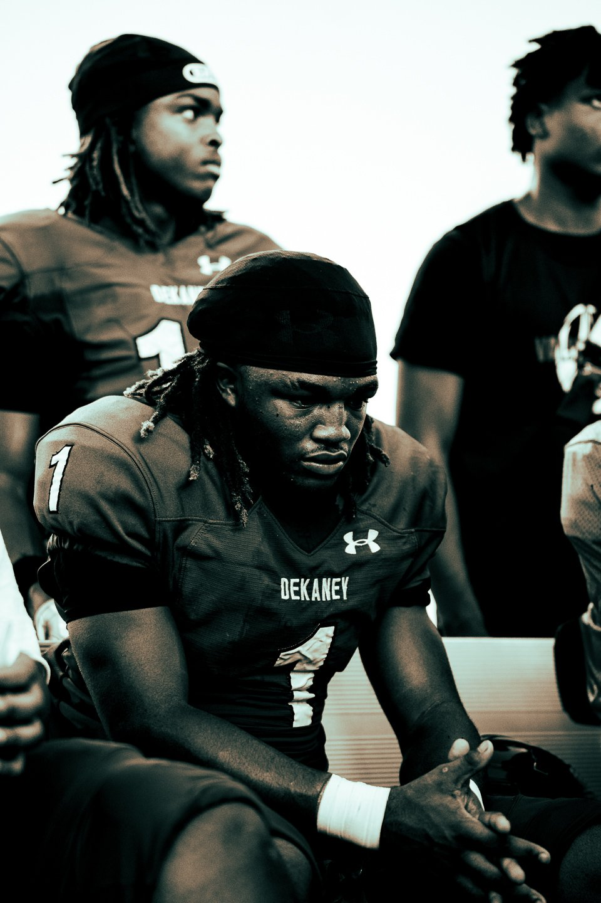

# Hassan Shot It — Website

Your site is plain HTML/CSS/JS — no build tools, no framework, works anywhere. It's now loaded with your real photos from your portfolio folder (62 shots) and your reel video, organized by sport.

## How to preview it right now

Just double-click `index.html` and it'll open in your browser. That's it.

## How to put it online

Any of these work and are free or cheap:

- **Netlify Drop** — go to app.netlify.com/drop and drag this whole folder in. Live in about 10 seconds, gives you a link you can share today.
- **Vercel / GitHub Pages** — good if you want a custom domain later.
- Ask me and I can walk you through connecting a domain like hassanshotit.com once you've got one.

## What's in the portfolio grid

All 62 photos from your `portfolio` folder are in, sorted by sport based on what's in each shot:

- **Football** — 35 photos
- **Soccer** — 13 photos
- **Basketball** — 8 photos
- **Track & Field / Other** — 6 photos (golf, baseball, track, and a couple that didn't clearly fit elsewhere)

I went through every photo and sorted it by eye — there's a small chance one or two landed in the wrong bucket. If you spot one, just move its `<figure>` block in `index.html` to a different `data-category` (see below) or tell me which ones and I'll fix it.

Your reel video (from the "video portfolio" folder) is featured in its own section between the photo grid and Services — compressed for web (15MB) with a custom poster frame and play button.

## How to add or swap photos

Every portfolio image lives in `assets/portfolio/`, named like `football-01.jpg`, `basketball-03.jpg`, `soccer-07.jpg`, `other-02.jpg`.

**To swap one out:** replace the file in `assets/portfolio/` with a new photo using the exact same filename.

**To add a new one:** open `index.html`, find the `<div class="grid" id="portfolioGrid">` section, copy one `<figure>...</figure>` block, and change the filename/category:

```html
<figure class="grid-item reveal" data-category="football">
  
  <figcaption><span>Football</span>Game Day Coverage</figcaption>
</figure>
```

`data-category` controls which filter button shows it — use `football`, `basketball`, `soccer`, or `other`.

Photos look best resized to about 1920px on the long edge — full-size camera originals will work but make the page slow to load.

## How to add photos from your phone

- **AirDrop** them to your Mac, then drag into `assets/portfolio/`.
- Or text/email them to yourself and save to that folder.

## Where to edit text

Your bio, services, pricing note, and nav links are plain text inside `index.html`. Open it in any text editor and it's readable top to bottom, organized by section with comments like `<!-- ABOUT -->`.

## What's already wired up

- Contact form opens the visitor's email app pre-filled, addressed to hassanshotit@gmail.com (no backend needed — static site).
- Phone, email, and Instagram (@hassanshotit) links throughout.
- Portfolio filters by sport work out of the box.
- Reel section with custom play button.
- Fully responsive — looks right on phone, tablet, and desktop.

## The "cooler" pass — what's new

- **Click any photo to open it full-size** in a lightbox, with arrow-key or on-screen prev/next navigation and Escape to close.
- **A thin progress bar at the top of the page** fills in as visitors scroll, so they always know how far through the site they are.
- **The nav bar highlights the section you're currently viewing** (Work, About, Services, Contact light up as you scroll past them).
- **A soft cursor glow** follows your mouse in the hero section and across the service cards on desktop — subtle, not gimmicky.
- All of this is desktop-only where it matters (touch devices skip the cursor/hover effects automatically), so it doesn't change anything about how the site behaves on mobile.

## A note on your "Brand Media" work

Your `portfolio` folder was all sports shots, so the Services section still describes your brand/company media work, but there's no photo grid category for it yet since I didn't want to mix real photos with filler. Once you've got a few brand/company shoots to show, send them over and I'll add a "Brand Media" filter tab back in.

## Files

```
index.html              the whole site
css/style.css            all styling
js/script.js              filtering, mobile menu, animations, contact form, reel player
assets/logo.png            your original logo file
assets/logo-trans.png        trimmed, transparent version (used in nav/footer)
assets/portfolio/           your 62 real photos, organized by sport
assets/reel/               your reel video + poster frame
```

Good luck with the meetings this week.
